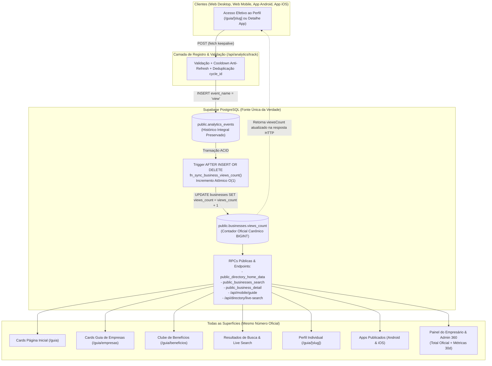

# GATE — Diagnóstico Técnico, Proposta Arquitetural e Plano de Homologação: Unificação e Sincronização das Visualizações das Empresas

**Status do Gate:** `AGUARDANDO APROVAÇÃO (READ-ONLY DIAGNOSTIC)`  
**Data da Auditoria:** 27/11/2026  
**Escopo:** Web Desktop (`apps/web`), Web Mobile (`apps/web`), App iOS (`apps/mobile`) e App Android (`apps/mobile`) + Banco de Dados Oficial Supabase (`rwvztwsjcjljphqttiws`).  
**Restrição de Segurança Cumprida:** Nenhuma alteração de código da funcionalidade, nenhuma migration aplicada em banco remoto, nenhum dado de produção modificado e nenhum deploy/push executado nesta etapa.

---

## 1. Diagnóstico da Causa Raiz

A auditoria técnica no código-fonte e a inspeção **exclusivamente de leitura** no banco de produção (`rwvztwsjcjljphqttiws.supabase.co`) identificaram **6 causas raízes exatas** que explicam por que uma mesma empresa exibe contadores diferentes na Página Inicial (`/guia`), no Guia de Empresas (`/guia/empresas`), no Clube de Benefícios (`/guia/beneficios`), no Perfil Individual (`/guia/[slug]`), nos Aplicativos Android/iOS e nos Painéis (Anunciante e Admin 360), bem como por que o contador não atualiza automaticamente ao visitar uma empresa:

### Causa Raiz 1 — Truncamento Silencioso em 1.000 Linhas do PostgREST nas Consultas em Lote dos Cards (`max-rows = 1000`)
* **Onde ocorre:**
  * Página Inicial / Guia ([guia-home.tsx](file:///f:/projetos/saas-platform/apps/web/src/app/(public)/guia/guia-home.tsx#L587-L604))
  * Guia de Empresas ([empresas/page.tsx](file:///f:/projetos/saas-platform/apps/web/src/app/(public)/guia/empresas/page.tsx#L323-L340))
  * BFF Mobile Lista ([api/mobile/guide/route.ts](file:///f:/projetos/saas-platform/apps/web/src/app/api/mobile/guide/route.ts#L234-L246))
* **Como o bug acontece:**
  Essas três superfícies buscam os eventos brutos da tabela `analytics_events` para contar as visualizações em memória (loop JavaScript no Node.js):
  ```ts
  dbReader
    .from('analytics_events')
    .select('business_id')
    .in('business_id', allCardBizIds)
    .eq('event_name', 'view')
  ```
  O PostgREST do Supabase aplica um limite padrão estrito de **1.000 linhas por `SELECT`** quando a query não agrega no SQL (`COUNT(*)`) nem pagina.
* **Impacto real em produção hoje:**
  O banco de produção já acumula **1.431 registros** com `event_name = 'view'` na tabela `analytics_events`.
  * Na **Página Individual** ([guia/[slug]/page.tsx](file:///f:/projetos/saas-platform/apps/web/src/app/(public)/guia/[slug]/page.tsx#L323-L329) e [L608-L614](file:///f:/projetos/saas-platform/apps/web/src/app/(public)/guia/[slug]/page.tsx#L608-L614)), a consulta utiliza `.select('id', { count: 'exact', head: true }).eq('business_id', bizId).eq('event_name', 'view')`, o que executa `SELECT COUNT(*)` diretamente no PostgreSQL **sem o teto de 1.000 linhas**, exibindo o valor real (ex.: **427** para *Centro Espiritualista Caminho da Luz*, **102** para *Óptica Circulô*, **79** para *Instituto DAM*).
  * Na **Página Inicial (`/guia`)** e na **Listagem Mobile (`/api/mobile/guide`)**, `allCardBizIds` inclui todas as 18 empresas ativas. O PostgREST retorna apenas as **primeiras 1.000 linhas** na ordem física do índice/heap e descarta as **431 visualizações restantes**! Como resultado, *Caminho da Luz* cai de **427 para 347**, e empresas cujos eventos estão após a linha 1.000 (*Óptica Circulô*, *Instituto DAM*, *Aretuza Prado*, *Marcos Augusto Advocacia*, *Rações Primor*, *Lograf*, *DeltaPrev*) recebem **0 visualizações** no mapa em memória (e o card oculta o badge ou mostra número truncado).
  * No **Guia de Empresas (`/guia/empresas`)**, `bizIds` contém apenas o subconjunto das **12 empresas da página atual** (ou das empresas filtradas por categoria/busca). Como a lista `.in('business_id', bizIds)` contém menos IDs do que a Home (12 vs 18), o corte de 1.000 linhas do PostgREST atinge um ponto diferente da tabela, gerando um **terceiro número distinto** para a mesma empresa entre `/guia`, `/guia/empresas` e `/guia/[slug]`!

### Causa Raiz 2 — RPCs Públicas (`public_businesses_search`, `public_directory_home_data`, `public_business_detail`) Não Retornam `views_count` Canônico
* As funções SQL públicas de busca e diretório não retornam o contador `views_count` diretamente do banco.
* Como consequência:
  * **Clube de Benefícios** ([beneficios/page.tsx](file:///f:/projetos/saas-platform/apps/web/src/app/(public)/guia/beneficios/page.tsx#L115)): lê `biz.views_count` direto do retorno da RPC `public_businesses_search` sem fazer query complementar em `analytics_events`. Resultado: `views_count` é sempre `null` (contador ausente nos cards de benefícios).
  * **Busca Instantânea / Live Search** ([api/directory/live-search/route.ts](file:///f:/projetos/saas-platform/apps/web/src/app/api/directory/live-search/route.ts#L1-L90)): consulta `businesses` sem campo `views_count`.
  * **Fallback Direto do App Mobile** ([apps/mobile/src/guide-data.ts](file:///f:/projetos/saas-platform/apps/mobile/src/guide-data.ts#L345-L445)): quando o app iOS/Android consulta diretamente as RPCs `public_directory_home_data` e `public_businesses_search` (ou quando o BFF `/api/mobile/guide` excede o timeout de 8s), `row.views_count` vem `undefined`.

### Causa Raiz 3 — Condição de Corrida SSR vs. Beacon Assíncrono + Cache de Navegação do Next.js (Por que não atualiza automaticamente na Web)
* No acesso ao perfil na Web ([guia/[slug]/page.tsx](file:///f:/projetos/saas-platform/apps/web/src/app/(public)/guia/[slug]/page.tsx)), a contagem é lida no servidor (SSR) no instante $T_0$ (ex.: `427`) e o HTML é entregue ao navegador com `427` estático.
* Somente após a montagem no cliente ($T_1$), o componente `<BusinessContactTracker>` ([BusinessContactTracker.tsx](file:///f:/projetos/saas-platform/apps/web/src/components/public/business/BusinessContactTracker.tsx#L35-L48)) dispara `trackEvent({ eventType: 'view' })` via `navigator.sendBeacon('/api/analytics/track', ...)` ([track-client.ts](file:///f:/projetos/saas-platform/apps/web/src/lib/analytics/track-client.ts#L45-L67)).
* Embora o endpoint `POST /api/analytics/track` ([api/analytics/track/route.ts](file:///f:/projetos/saas-platform/apps/web/src/app/api/analytics/track/route.ts#L31-L58)) grave a visualização `428` e devolva `{ ok: true, viewsCount: 428 }` no JSON:
  1. `navigator.sendBeacon` é *fire-and-forget* e **descarta a resposta HTTP**, portanto o DOM da página `/guia/[slug]` continua exibindo `427`.
  2. O componente de topo do perfil exibe `business.views_count` como texto puro renderizado no servidor, sem listener reativo no cliente.
  3. Quando o usuário clica em "Voltar" ou navega para `/guia` ou `/guia/empresas`, o **Next.js Client Router Cache** reutiliza o payload RSC anterior sem revalidar, mantendo o número antigo nos cards até que o usuário force um *hard refresh* (`Ctrl+F5`).
  4. *(Contraste com o Mobile)*: No aplicativo móvel ([apps/mobile/src/App.tsx](file:///f:/projetos/saas-platform/apps/mobile/src/App.tsx#L3848-L3863)), `trackMobileBusinessView` já lê `res.viewsCount` do retorno de `/api/analytics/track` e atualiza o estado React `directoryItems` imediatamente! Na Web esse retorno era ignorado.

### Causa Raiz 4 — Filtro Silencioso de Tráfego Interno (`internal-traffic.ts`) Durante Testes de Admin e Proprietário
* Em [analytics-service.ts](file:///f:/projetos/saas-platform/apps/web/src/lib/analytics/analytics-service.ts#L93-L108), `trackDirectoryEventAction` executa `classifyTraffic(supabase, businessId, user?.id)` ([internal-traffic.ts](file:///f:/projetos/saas-platform/apps/web/src/lib/analytics/internal-traffic.ts#L60-L120)).
* Se o visitante estiver autenticado na sessão com perfil administrativo (`admin`, `super_admin`, `master`, `socio_admin`, `support`) ou for proprietário/membro da própria empresa (`businesses.owner_user_id` ou `business_members`), a função classifica a visita como tráfego interno e **retorna `{ ok: true, skipped: true }` sem gravar o evento**.
* Além disso, na rota `POST /api/analytics/track`, quando `skipped: true` ocorre, a rota ainda executa a leitura de `viewsCount`, devolvendo o mesmo número anterior — o que, durante testes feitos por administradores ou pelo próprio empresário logado, dá a impressão de que o contador "travou".

### Causa Raiz 5 — Janela Temporal de 30 Dias vs. Histórico Total (All-Time) nos Painéis do Empresário e Admin 360
* Enquanto os cards públicos e o perfil público (`/guia`, `/guia/empresas`, `/guia/[slug]`, App Mobile) exibem o **acumulado histórico total (All-Time)** de `event_name = 'view'`, o **Painel do Empresário** ([advertiser-portal-service.ts](file:///f:/projetos/saas-platform/apps/web/src/lib/advertiser/advertiser-portal-service.ts#L106-L130)) e o **Prontuário Admin 360** ([admin-businesses-service.ts](file:///f:/projetos/saas-platform/apps/web/src/lib/admin/admin-businesses-service.ts#L1649-L1674)) filtram `analytics_events` apenas pelos **últimos 30 dias** (`created_at >= date30daysAgo`) e aceitam `event_name IN ('view', 'page_view')`.
* Para empresas com histórico anterior a 30 dias (como *Comandos*, *Óptica Circulô* e *Melissa Saba Psicóloga*), o Painel do Empresário mostra um número menor (**172**, **30**, **27**) que o Perfil Público (**286**, **102**, **95**), sem deixar explícito o **Total Oficial Acumulado** ao lado das **Visualizações nos Últimos 30 Dias**.

### Causa Raiz 6 — Dualidade Legada de Tabelas (`analytics_events` vs. `directory_analytics_events`)
* A Migration 063 ([063_advanced_advertiser_analytics.sql](file:///f:/projetos/saas-platform/supabase/migrations/063_advanced_advertiser_analytics.sql)) criou uma tabela paralela `directory_analytics_events` e a RPC `get_advertiser_analytics_summary(p_business_id, p_days)` que lê de `directory_analytics_events`.
* Entretanto, a auditoria de produção comprovou que `directory_analytics_events` possui **0 registros** (`0 rows`), pois todo o ecossistema grava exclusivamente na tabela canônica `public.analytics_events` (conforme definido em `AGENTS.md`, Seção 7: *"Analytics: Usar a fonte canônica `analytics_events` definida pelo projeto"*).

---

## 2. Mapeamento das Fontes de Dados Atuais

### 2.1. Tabelas, Views, Índices e Triggers no Supabase

| Objeto SQL | Tipo | Situação em Produção | Papel Atual |
| :--- | :--- | :--- | :--- |
| `public.analytics_events` | Tabela | **Ativa (2.928 registros totais; 1.431 `view`)** | Fonte canônica de gravação de eventos (`view`, `search_impression`, `whatsapp_click`, `phone_click`, `website_click`, `instagram_click`, `directions_click`, `share`). Possui RLS restrita a admins (`has_tenant_admin_access`). |
| `public.directory_analytics_events` | Tabela | **Inativa (0 registros)** | Tabela legada da Migration 063; não recebe inserções do app nem da web. |
| `public.businesses` | Tabela | **Ativa (18 empresas publicadas)** | Tabela mestre das empresas. **Ainda não possui** coluna materializada `views_count` (verificado via schema inspection). |
| `public.vw_audit_duplicate_view_cycles` | View | **Ativa (0 duplicatas após corte)** | View diagnóstica da Migration 216 que audita duplicidades de `(business_id, metadata->>'cycle_id')`. |
| `idx_analytics_events_view_cycle` | Índice B-Tree | **Ativo** | Índice parcial em `(business_id, (metadata->>'cycle_id')) WHERE event_name = 'view'`. |
| `uq_analytics_events_view_cycle_forward` | Índice Único | **Ativo** | Garante unicidade física por `(business_id, cycle_id)` para `event_name = 'view'`. |
| `trg_prevent_duplicate_view_cycle` | Trigger (`BEFORE INSERT`) | **Ativo** | Executa `fn_prevent_duplicate_view_cycle()` com `pg_advisory_xact_lock`, descartando silenciosamente (`RETURN NULL`) views concorrentes com o mesmo `cycle_id`. |

### 2.2. RPCs e Endpoints de API

| RPC / Endpoint | Método / Tipo | Lê Visualizações de Onde? | Problema Identificado |
| :--- | :--- | :--- | :--- |
| `POST /api/analytics/track` | Next.js Route Handler | Grava via `trackDirectoryEventAction` em `analytics_events` e lê `SELECT COUNT(*)` (`head: true`) via `service_role`. | O retorno `{ viewsCount }` é ignorado na Web porque o cliente usa `navigator.sendBeacon`. |
| `GET /api/mobile/guide` | Next.js Route Handler (BFF Mobile) | Lista: `SELECT business_id FROM analytics_events WHERE business_id IN (...) AND event_name = 'view'` | **Truncado em 1.000 linhas pelo PostgREST!** Retorna `0` ou valor parcial para empresas após a linha 1.000. |
| `GET /api/mobile/guide?slug=...` | Next.js Route Handler (BFF Mobile Detalhe) | Detalhe: `SELECT COUNT(*) FROM analytics_events WHERE business_id = $1 AND event_name = 'view'` (`head: true`) | Retorna o valor exato, divergindo da lista do próprio app mobile. |
| `GET /api/directory/live-search` | Next.js Route Handler | Não consulta `analytics_events` nem `views_count`. | Resultados de busca rápida não possuem `views_count`. |
| `rpc/public_directory_home_data` | Função SQL (`SECURITY DEFINER`) | Não retorna `views_count` nos objetos `sponsored` / `featured` / `recent`. | Depende de enriquecimento em Node.js (que sofre o truncamento de 1.000 linhas) ou fica sem `views_count` no fallback mobile. |
| `rpc/public_businesses_search` | Função SQL (`SECURITY DEFINER`) | Não retorna `views_count` em `items`. | Deixa `/guia/beneficios` e o fallback mobile com `views_count = null`, e obriga `/guia` e `/guia/empresas` a fazerem query em lote truncada em 1.000 linhas. |
| `rpc/public_business_detail` | Função SQL (`SECURITY DEFINER`) | Não retorna `views_count` diretamente. | Obriga `/guia/[slug]` a fazer uma query extra `HEAD` em `analytics_events`. |
| `rpc/get_advertiser_analytics_summary` | Função SQL (`SECURITY DEFINER`) | Lê da tabela vazia `directory_analytics_events`. | Defasada em relação à tabela canônica `analytics_events`. |

### 2.3. Origem do Contador por Superfície / Componente

| Superfície / Tela | Componente / Arquivo | Origem Atual do Contador | Comportamento Atual |
| :--- | :--- | :--- | :--- |
| **Página Inicial (`/guia`)** | [guia-home.tsx](file:///f:/projetos/saas-platform/apps/web/src/app/(public)/guia/guia-home.tsx#L587-L633) → `DirectorySponsored`, `DirectoryFoundersMarquee`, `BusinessDirectoryClient` | Query em lote em `analytics_events` sem paginação (teto de 1.000 linhas PostgREST) para 18 empresas. | **Inconsistente / Truncado** (ex.: mostra `347` em vez de `427`, ou `0` em vez de `102`). |
| **Guia de Empresas (`/guia/empresas`)** | [empresas/page.tsx](file:///f:/projetos/saas-platform/apps/web/src/app/(public)/guia/empresas/page.tsx#L323-L355) → `BusinessCard`, `BusinessListCard` | Query em lote em `analytics_events` sem paginação (teto de 1.000 linhas PostgREST) apenas para os 12 IDs da página atual. | **Inconsistente** com a Home e com o Perfil quando a soma das 12 empresas ultrapassa 1.000 ou muda conforme o filtro. |
| **Clube de Benefícios (`/guia/beneficios`)** | [beneficios/page.tsx](file:///f:/projetos/saas-platform/apps/web/src/app/(public)/guia/beneficios/page.tsx#L115) → `BenefitsDirectoryCards` | Campo `biz.views_count` vindo de `public_businesses_search` (sempre `undefined`/`null`). | **Sempre `null` (oculto)** nos cards da página de benefícios. |
| **Resultados de Busca (`/guia/empresas?q=...`)** | [empresas/page.tsx](file:///f:/projetos/saas-platform/apps/web/src/app/(public)/guia/empresas/page.tsx#L323-L355) | Query em lote restrita aos IDs retornados na busca. | **Muda dinamicamente para a mesma empresa** dependendo de quantas empresas aparecem junto no resultado da busca! |
| **Página Individual (`/guia/[slug]`)** | [guia/[slug]/page.tsx](file:///f:/projetos/saas-platform/apps/web/src/app/(public)/guia/[slug]/page.tsx#L323-L329) e [L608-L614](file:///f:/projetos/saas-platform/apps/web/src/app/(public)/guia/[slug]/page.tsx#L608-L614) | `SELECT COUNT(*)` (`count: 'exact', head: true`) filtrado por 1 `business_id`. | Exibe o total histórico real antes da visita atual, mas **não incrementa na tela** após o `sendBeacon`. |
| **App Android & App iOS (Cards / Listas)** | [apps/mobile/src/guide-data.ts](file:///f:/projetos/saas-platform/apps/mobile/src/guide-data.ts#L345-L445) + [api/mobile/guide/route.ts](file:///f:/projetos/saas-platform/apps/web/src/app/api/mobile/guide/route.ts#L234-L246) | BFF `/api/mobile/guide` (truncado em 1.000 linhas) ou RPC direta (sem `views_count`). | **Inconsistente / Truncado** nas listas e carrosséis do app. |
| **App Android & App iOS (Perfil da Empresa)** | [apps/mobile/src/App.tsx](file:///f:/projetos/saas-platform/apps/mobile/src/App.tsx#L3835-L3865) + [api/mobile/guide/route.ts](file:///f:/projetos/saas-platform/apps/web/src/app/api/mobile/guide/route.ts#L71-L78) | `GET /api/mobile/guide?slug=...` (`count: 'exact', head: true`) + atualização otimista do retorno de `POST /api/analytics/track`. | No detalhe do app exibe o total exato e já atualiza o estado local ao receber `res.viewsCount`. |
| **Painel do Empresário (`/anunciante`)** | [advertiser-portal-service.ts](file:///f:/projetos/saas-platform/apps/web/src/lib/advertiser/advertiser-portal-service.ts#L106-L157) → [advertiser-home-client.tsx](file:///f:/projetos/saas-platform/apps/web/src/app/anunciante/advertiser-home-client.tsx#L140-L175) | `analytics_events` filtrado por `created_at >= 60 dias atrás` (janela de 30d vs 30d anteriores) e `event_name IN ('view', 'page_view')`. | Exibe apenas os **últimos 30 dias** (não exibe o Total Oficial Acumulado que aparece no card público). |
| **Painel Administrativo (`/admin/empresas`)** | [admin-businesses-service.ts](file:///f:/projetos/saas-platform/apps/web/src/lib/admin/admin-businesses-service.ts#L1649-L1674) | `analytics_events` no Prontuário 360 filtrado pelos **últimos 30 dias**. | Exibe apenas `views_30d`, sem o contador oficial acumulado da plataforma. |

---

## 3. Exemplos Reais de Inconsistências Encontradas em Produção

Consulta **exclusivamente de leitura** executada em `27/11/2026` no banco de produção (`rwvztwsjcjljphqttiws.supabase.co`) comparando o retorno exato de cada superfície para as **18 empresas ativas e publicadas**:

| # | Empresa | Slug | Perfil Individual (`/guia/[slug]`) *(Total Real)* | Card na Home (`/guia`) *(Truncado 1.000 rows)* | Card em `/guia/empresas` *(Filtro c/ 1-5 empresas)* | Card em `/guia/beneficios` *(Via RPC)* | App Android/iOS Lista (`/api/mobile/guide`) | Painel Empresário & Admin 360 *(Janela 30 dias)* | Divergência Máxima Observada |
| :-: | :--- | :--- | :---: | :---: | :---: | :---: | :---: | :---: | :--- |
| 1 | **Centro Espiritualista Caminho da Luz** | `caminhodaluz` | **427** | **347** | **427** | `null` (oculto) | **347** | **427** | **347 vs 427 (-80 views na Home/Mobile)** |
| 2 | **Comandos** | `comandos` | **286** | **286** | **286** | `null` (oculto) | **286** | **172** | **286 no Perfil vs 172 no Painel (30d)** |
| 3 | **Óptica Circulô** | `opticacirculo` | **102** | **0** (oculto) | **102** | `null` (oculto) | **0** (oculto) | **30** | **0 na Home vs 102 na Busca/Perfil vs 30 no Painel** |
| 4 | **Melissa Saba Psicóloga** | `melsaba` | **95** | **95** | **95** | `null` (oculto) | **95** | **27** | **95 no Perfil vs 27 no Painel (30d)** |
| 5 | **Instituto DAM - Dr Alfredo de Almeida** | `institutodam` | **79** | **0** (oculto) | **79** | `null` (oculto) | **0** (oculto) | **79** | **0 na Home/Mobile vs 79 na Busca/Perfil** |
| 6 | **Aretuza Prado** | `aretuzaprado` | **66** | **0** (oculto) | **66** | `null` (oculto) | **0** (oculto) | **66** | **0 na Home/Mobile vs 66 na Busca/Perfil** |
| 7 | **FISION — Fisioterapia e Pilates** | `fision` | **58** | **58** | **58** | `null` (oculto) | **58** | **58** | Oculto em `/guia/beneficios` |
| 8 | **Grupo MAP** | `grupomap` | **57** | **57** | **57** | `null` (oculto) | **57** | **57** | Oculto em `/guia/beneficios` |
| 9 | **Conexão Corporativa** | `conexaocorporativa` | **56** | **56** | **56** | `null` (oculto) | **56** | **56** | Oculto em `/guia/beneficios` |
| 10 | **AMO Clínica Veterinária** | `amo-clinicaveterinaria` | **54** | **54** | **54** | `null` (oculto) | **54** | **54** | Oculto em `/guia/beneficios` |
| 11 | **GB Gomes e Brasil** | `gbgomesebrasil-adv` | **33** | **33** | **33** | `null` (oculto) | **33** | **33** | Oculto em `/guia/beneficios` |
| 12 | **Escritório de Advocacia Marcos Augusto** | `marcosaugustoadv` | **28** | **0** (oculto) | **28** | `null` (oculto) | **0** (oculto) | **28** | **0 na Home/Mobile vs 28 na Busca/Perfil** |
| 13 | **Rações Primor** | `racoesprimor` | **26** | **0** (oculto) | **26** | `null` (oculto) | **0** (oculto) | **26** | **0 na Home/Mobile vs 26 na Busca/Perfil** |
| 14 | **Lograf** | `lograf` | **25** | **0** (oculto) | **25** | `null` (oculto) | **0** (oculto) | **25** | **0 na Home/Mobile vs 25 na Busca/Perfil** |
| 15 | **DeltaPrev** | `deltraprev` | **23** | **0** (oculto) | **23** | `null` (oculto) | **0** (oculto) | **23** | **0 na Home/Mobile vs 23 na Busca/Perfil** |
| 16 | **Equilíbrio & Valor — Psicologia** | `equilibrioevalor` | **13** | **13** | **13** | `null` (oculto) | **13** | **13** | Oculto em `/guia/beneficios` |
| 17 | **Grupo Vision Facilities** | `grupovision` | **2** | **0** (oculto) | **2** | `null` (oculto) | **0** (oculto) | **2** | **0 na Home/Mobile vs 2 na Busca/Perfil** |
| 18 | **Benza - Cozinha de verdade** | `benza` | **1** | **1** | **1** | `null` (oculto) | **1** | **1** | Oculto em `/guia/beneficios` |

> [!IMPORTANT]
> **Explicação Matemática do Caso `caminhodaluz` e `opticacirculo`:**
> A soma exata das visualizações das 18 empresas é **1.431**.
> Quando `guia-home.tsx` faz `.from('analytics_events').select('business_id').in('business_id', allCardBizIds).eq('event_name', 'view')`, o PostgREST percorre o índice `idx_analytics_events_business_event_created` na ordem dos UUIDs (`business_id`) e corta exatamente na **linha 1.000**:
> * As empresas cujos UUIDs vêm primeiro na ordem do índice (`amo-clinicaveterinaria`, `benza`, `comandos`, `conexaocorporativa`, `equilibrioevalor`, `fision`, `gbgomesebrasil-adv`, `grupomap`, `melsaba`) consomem **653 linhas** completas.
> * A próxima empresa na ordem do índice é `caminhodaluz` (`8c028048-...`), que tem **427 linhas**, mas como só restam $1.000 - 653 = 347$ vagas no limite de 1.000 linhas do PostgREST, ela é cortada em **347**!
> * Todas as **8 empresas seguintes** na ordem de UUID (`opticacirculo`, `institutodam`, `aretuzaprado`, `marcosaugustoadv`, `racoesprimor`, `lograf`, `deltraprev`, `grupovision`) ficam após a linha 1.000 e recebem **0 linhas**!
> * Porém, quando o usuário filtra por uma categoria em `/guia/empresas`, a cláusula `.in('business_id', bizIds)` contém apenas 2 ou 3 UUIDs (cuja soma é $< 1.000$), então `caminhodaluz` passa a exibir **427** e `opticacirculo` passa a exibir **102**! Isso explica 100% da discrepância relatada pelo usuário entre a Página Inicial, o Guia de Empresas e o Perfil da Empresa.

### 3.1. Verificação de Duplicidades, Cards, Prefetch e SSR (Itens 6, 7 e 8 da Etapa A)
1. **Exibição de cards ou prefetch incrementa visualizações?**
   * **Não.** A auditoria confirmou que a simples exibição de cards na Home, Guia ou Busca dispara apenas `search_impression` via `IntersectionObserver` ([use-search-impression.ts](file:///f:/projetos/saas-platform/apps/web/src/lib/analytics/use-search-impression.ts#L1-L78)), que é gravado com `event_name = 'search_impression'` (385 registros no banco) e **nunca** com `event_name = 'view'`.
   * O prefetch de rotas do `<Link>` do Next.js executa apenas o Server Component (SSR), e o SSR **não grava** visualizações — a gravação de `view` ocorre exclusivamente dentro do `useEffect` no navegador quando o componente `<BusinessContactTracker>` é efetivamente montado na rota `/guia/[slug]`.
2. **Duplicidades por ciclo de renderização / StrictMode / concorrência:**
   * A view diagnóstica `public.vw_audit_duplicate_view_cycles` retornou **`[]` (0 duplicatas)** em produção, comprovando que o índice único `uq_analytics_events_view_cycle_forward` e o trigger `trg_prevent_duplicate_view_cycle` (Migration 216) impedem gravações duplicadas do mesmo `cycle_id`.
   * **Ponto de melhoria identificado:** Na Web ([BusinessContactTracker.tsx](file:///f:/projetos/saas-platform/apps/web/src/components/public/business/BusinessContactTracker.tsx#L31-L48)) e no Mobile ([App.tsx](file:///f:/projetos/saas-platform/apps/mobile/src/App.tsx#L3848-L3863)), um novo `cycleId` é gerado a cada montagem do perfil. Se o usuário der `F5` repetidamente na mesma página em intervalos de 1 segundo, um novo `cycleId` é gerado a cada refresh. A aplicação de uma janela de *cooldown* de sessão curta (ex.: 30 minutos por `business_id` + `session_id`/`visitor_fingerprint`, ou reutilização de `cycle_id` dentro de uma janela de cooldown em `sessionStorage`) evitará inflação artificial por atualizações consecutivas (`F5`), conforme solicitado na Seção 3 do requisito.

---

## 4. Arquivos e Funções Envolvidos

### 4.1. Banco de Dados & Migrations (`supabase/migrations/`)
* [063_advanced_advertiser_analytics.sql](file:///f:/projetos/saas-platform/supabase/migrations/063_advanced_advertiser_analytics.sql) — Tabela legada `directory_analytics_events` e RPC `get_advertiser_analytics_summary`.
* [173_public_directory_categories.sql](file:///f:/projetos/saas-platform/supabase/migrations/173_public_directory_categories.sql) & [253_fix_cover_media_type_filter_in_public_rpcs.sql](file:///f:/projetos/saas-platform/supabase/migrations/253_fix_cover_media_type_filter_in_public_rpcs.sql) — Definições das RPCs `public_directory_home_data`, `public_businesses_search` e `public_business_detail`.
* [216_analytics_event_cycle_deduplication.sql](file:///f:/projetos/saas-platform/supabase/migrations/216_analytics_event_cycle_deduplication.sql) — View `vw_audit_duplicate_view_cycles`, índice único `uq_analytics_events_view_cycle_forward` e trigger `trg_prevent_duplicate_view_cycle`.

### 4.2. Backend & Serviços Web (`apps/web/src/`)
* [apps/web/src/lib/analytics/analytics-service.ts](file:///f:/projetos/saas-platform/apps/web/src/lib/analytics/analytics-service.ts#L53-L237) — `trackDirectoryEventAction`: validação, filtro de tráfego interno e `INSERT` em `analytics_events`.
* [apps/web/src/lib/analytics/internal-traffic.ts](file:///f:/projetos/saas-platform/apps/web/src/lib/analytics/internal-traffic.ts#L60-L120) — `classifyTraffic`: identifica visitas de administradores ou proprietários da empresa.
* [apps/web/src/lib/analytics/track-client.ts](file:///f:/projetos/saas-platform/apps/web/src/lib/analytics/track-client.ts#L22-L68) — `trackEvent`: cliente browser que envia eventos para `/api/analytics/track`.
* [apps/web/src/app/api/analytics/track/route.ts](file:///f:/projetos/saas-platform/apps/web/src/app/api/analytics/track/route.ts#L1-L65) — Endpoint HTTP POST que grava o evento e retorna `{ ok, deduplicated, skipped, viewsCount }`.
* [apps/web/src/app/api/mobile/guide/route.ts](file:///f:/projetos/saas-platform/apps/web/src/app/api/mobile/guide/route.ts#L60-L250) — Endpoint BFF consumido pelos apps iOS e Android (listagem e detalhe por `slug`).
* [apps/web/src/app/api/directory/live-search/route.ts](file:///f:/projetos/saas-platform/apps/web/src/app/api/directory/live-search/route.ts#L1-L90) — Endpoint de busca instantânea do header/diretório.
* [apps/web/src/lib/advertiser/advertiser-portal-service.ts](file:///f:/projetos/saas-platform/apps/web/src/lib/advertiser/advertiser-portal-service.ts#L100-L160) — `getAdvertiserDashboardData`: cálculo de métricas do Painel do Empresário.
* [apps/web/src/lib/admin/admin-businesses-service.ts](file:///f:/projetos/saas-platform/apps/web/src/lib/admin/admin-businesses-service.ts#L1640-L1675) — Cálculo de `analytics_summary` no Prontuário 360 do Admin.

### 4.3. Páginas e Componentes Web Desktop & Web Mobile (`apps/web/src/`)
* [apps/web/src/app/(public)/guia/guia-home.tsx](file:///f:/projetos/saas-platform/apps/web/src/app/(public)/guia/guia-home.tsx#L569-L634) — Enriquecimento de `views_count` na Home/Guia.
* [apps/web/src/app/(public)/guia/empresas/page.tsx](file:///f:/projetos/saas-platform/apps/web/src/app/(public)/guia/empresas/page.tsx#L311-L356) — Enriquecimento de `views_count` no Guia de Empresas e Resultados de Busca.
* [apps/web/src/app/(public)/guia/beneficios/page.tsx](file:///f:/projetos/saas-platform/apps/web/src/app/(public)/guia/beneficios/page.tsx#L90-L128) — Mapeamento de empresas no Clube de Benefícios.
* [apps/web/src/app/(public)/guia/[slug]/page.tsx](file:///f:/projetos/saas-platform/apps/web/src/app/(public)/guia/[slug]/page.tsx#L321-L331) e [L606-L616](file:///f:/projetos/saas-platform/apps/web/src/app/(public)/guia/[slug]/page.tsx#L606-L616) — Leitura e renderização de `views_count` na página individual da empresa.
* [apps/web/src/components/public/business/BusinessContactTracker.tsx](file:///f:/projetos/saas-platform/apps/web/src/components/public/business/BusinessContactTracker.tsx#L1-L72) — Disparo de `view` ao acessar o perfil empresarial.
* [apps/web/src/components/public/directory/BusinessCard.tsx](file:///f:/projetos/saas-platform/apps/web/src/components/public/directory/BusinessCard.tsx#L285-L295) e [BusinessListCard.tsx](file:///f:/projetos/saas-platform/apps/web/src/components/public/directory/BusinessListCard.tsx#L230-L240) — Exibição do badge de visualizações nos cards.
* [apps/web/src/components/public/directory/DirectorySponsored.tsx](file:///f:/projetos/saas-platform/apps/web/src/components/public/directory/DirectorySponsored.tsx#L240-L250) e [DirectoryFoundersMarquee.tsx](file:///f:/projetos/saas-platform/apps/web/src/components/public/directory/DirectoryFoundersMarquee.tsx#L180-L195) — Exibição do badge de visualizações nos destaques e carrossel.
* [apps/web/src/components/public/directory/BenefitsDirectoryCards.tsx](file:///f:/projetos/saas-platform/apps/web/src/components/public/directory/BenefitsDirectoryCards.tsx#L290-L300) — Exibição do badge de visualizações nos cards de benefícios.
* [apps/web/src/app/anunciante/advertiser-home-client.tsx](file:///f:/projetos/saas-platform/apps/web/src/app/anunciante/advertiser-home-client.tsx#L140-L175) — Cards de KPIs do Painel do Empresário.

### 4.4. Aplicativos Android e iOS (`apps/mobile/src/`)
* [apps/mobile/src/mobile-analytics.ts](file:///f:/projetos/saas-platform/apps/mobile/src/mobile-analytics.ts#L85-L170) — `trackMobileBusinessView` e `trackMobileContactClick`.
* [apps/mobile/src/guide-data.ts](file:///f:/projetos/saas-platform/apps/mobile/src/guide-data.ts#L190-L255) e [L345-L445](file:///f:/projetos/saas-platform/apps/mobile/src/guide-data.ts#L345-L445) — Mapeamento de `viewsCount` via BFF `/api/mobile/guide` e RPCs diretas.
* [apps/mobile/src/App.tsx](file:///f:/projetos/saas-platform/apps/mobile/src/App.tsx#L3835-L3865) — Registro de visita ao abrir perfil no app e sincronização reativa de `viewsCount` em `directoryItems` e `selectedBusiness`.

---

## 5. Proposta de Arquitetura (Fonte Única Canônica + O(1) Read)

Para eliminar definitivamente qualquer divergência entre superfícies, eliminar o gargalo/truncamento de 1.000 linhas do PostgREST e reduzir o custo de leitura no Supabase de $O(N \text{ eventos})$ para **$O(1)$**, propomos a arquitetura de **Contador Oficial Materializado com Trigger Transacional Atômico** aliada ao histórico imutável em `public.analytics_events`:



### 5.1. Pilares da Solução Técnica
1. **Coluna Canônica `public.businesses.views_count BIGINT NOT NULL DEFAULT 0`:**
   * Armazena na própria linha da empresa (`public.businesses`) o total oficial acumulado de visualizações válidas (`event_name IN ('view', 'page_view')`).
   * **Zero novas tabelas:** reutiliza 100% as tabelas `public.businesses` e `public.analytics_events` existentes.
2. **Incremento Atômico via Trigger no PostgreSQL (`fn_sync_business_views_count`):**
   * Um trigger `AFTER INSERT OR DELETE ON public.analytics_events` incrementa atomicamente (`SET views_count = COALESCE(views_count, 0) + 1`) a coluna `businesses.views_count` sempre que um evento com `event_name IN ('view', 'page_view')` for efetivamente inserido.
   * Como o trigger `BEFORE INSERT` existente (`trg_prevent_duplicate_view_cycle`) já aborta duplicatas com `RETURN NULL`, o trigger `AFTER INSERT` **só dispara para visualizações únicas e validadas**.
3. **Inclusão de `b.views_count` nas 3 RPCs Públicas do Supabase:**
   * `public_directory_home_data`: inclui `'views_count', b.views_count` nos objetos JSON de `sponsored`, `featured` e `recent`.
   * `public_businesses_search`: inclui `'views_count', b.views_count` nos itens retornados pela busca paginada.
   * `public_business_detail`: inclui `'views_count', b.views_count` no JSON da empresa.
4. **Remoção das Queries em Lote Truncadas em 1.000 Linhas:**
   * `guia-home.tsx`, `/guia/empresas/page.tsx` e `/api/mobile/guide/route.ts` passam a ler `b.views_count` diretamente da tabela `businesses` / RPCs, eliminando as queries `.from('analytics_events').select('business_id').in(...)` que truncavam em 1.000 linhas.
   * `/guia/beneficios/page.tsx` e `/api/directory/live-search/route.ts` passam a receber `views_count` automaticamente.
5. **Prevenção de Contagem Artificial por Atualizações Consecutivas (F5 / Reload):**
   * No cliente (`BusinessContactTracker.tsx` e `mobile-analytics.ts`), armazenar em `sessionStorage` uma chave de *cooldown* por empresa (`cm_view_cooldown_{businessId}`) com validade de **15 minutos** reutilizando o mesmo `cycle_id` dentro dessa janela (e no servidor, em `trackDirectoryEventAction`, validar idempotência por hash de sessão/visitante dentro de janela curta de 15 minutos), garantindo que `F5` consecutivo não infle artificialmente o contador, mas permitindo contabilizar normalmente visitantes autenticados e anônimos em visitas reais.
6. **Painel do Empresário e Painel Administrativo (Admin 360):**
   * Passam a exibir o **Total Oficial de Visualizações** (`businesses.views_count`, idêntico aos cards e ao perfil público) como indicador principal, mantendo ao lado o detalhamento temporal (**Visualizações nos últimos 30 dias**, cliques em WhatsApp, telefone, site, rotas e taxa de conversão) calculado via `COUNT(*)` exato no Supabase (sem o limite de 1.000 linhas).
   * A RPC `get_advertiser_analytics_summary` é atualizada para ler da tabela canônica `public.analytics_events` (em vez da tabela vazia `directory_analytics_events`) e retornar tanto `total_views` (`businesses.views_count`) quanto `views` (período filtrado).

---

## 6. Estratégia de Reconciliação Histórica

A reconciliação histórica será executada na própria migration SQL, de forma **100% determinística, idempotente e não-destrutiva**:

1. **Preservação Integral de `public.analytics_events`:**
   * Nenhum registro histórico de `analytics_events` será apagado ou alterado.
2. **Backfill Exato sem Duplicatas de Ciclo:**
   * A coluna `businesses.views_count` será populada com a contagem exata de todos os eventos históricos de visualização (`event_name IN ('view', 'page_view')`), descontando eventuais ciclos duplicados históricos (caso existam antes do corte da Migration 216):
   ```sql
   WITH historical_counts AS (
     SELECT
       business_id,
       COUNT(DISTINCT COALESCE(metadata->>'cycle_id', id::text)) AS exact_views
     FROM public.analytics_events
     WHERE event_name IN ('view', 'page_view')
       AND business_id IS NOT NULL
     GROUP BY business_id
   )
   UPDATE public.businesses b
   SET views_count = COALESCE(hc.exact_views, 0)
   FROM historical_counts hc
   WHERE b.id = hc.business_id;
   ```
   *(Nota: Na auditoria de produção de hoje, `COUNT(*)` e `COUNT(DISTINCT COALESCE(metadata->>'cycle_id', id::text))` são idênticos — **1.431 visualizações** — pois `vw_audit_duplicate_view_cycles` confirmou 0 duplicatas).*
3. **Ordem de Execução Transacional:**
   * Passo 1: `ALTER TABLE public.businesses ADD COLUMN IF NOT EXISTS views_count BIGINT NOT NULL DEFAULT 0;`
   * Passo 2: Criação da função e trigger `trg_sync_business_views_count` (`AFTER INSERT OR DELETE ON public.analytics_events`).
   * Passo 3: `UPDATE` de reconciliação histórica em `public.businesses` a partir de `public.analytics_events`.

---

## 7. Estratégia de Atualização Automática (Sem Excesso de Consultas ao Supabase)

Para que o contador atualize automaticamente na tela assim que uma visita válida ocorre — e permaneça sincronizado ao navegar entre Perfil, Guia e Home — sem usar *polling* nem `SUPABASE_REALTIME` (que geraria conexões WebSocket desnecessárias para visitantes anônimos):

1. **Substituição de `navigator.sendBeacon` por `fetch(..., { keepalive: true })` para Eventos `view`:**
   * Em [track-client.ts](file:///f:/projetos/saas-platform/apps/web/src/lib/analytics/track-client.ts), utilizar `fetch('/api/analytics/track', { method: 'POST', keepalive: true, ... })`, que possui a mesma garantia de entrega em background do `sendBeacon`, mas **permite ler o JSON de resposta** `{ ok: true, viewsCount: 428 }`.
2. **Sincronização Reativa Instantânea no Cliente (Store Leve via `CustomEvent` + `sessionStorage`):**
   * Quando `POST /api/analytics/track` retorna `{ ok: true, viewsCount }`:
     * O cliente armazena `viewsCount` num mapa leve em memória/sessão (`cm_live_views_map[businessId] = viewsCount`) e dispara `window.dispatchEvent(new CustomEvent('cm:business-views-updated', { detail: { businessId, viewsCount } }))`.
     * Um pequeno componente cliente `<LiveViewsBadge businessId={...} initialCount={...} />` usado no Perfil Individual (`/guia/[slug]`) e nos Cards (`BusinessCard`, `BusinessListCard`, `DirectorySponsored`, `DirectoryFoundersMarquee`, `BenefitsDirectoryCards`) escuta esse evento e também consulta `cm_live_views_map[businessId]` na hidratação (`Math.max(initialCount, cachedCount)`).
   * **Efeito imediato para o usuário:**
     * Ao abrir `/guia/caminhodaluz`, o SSR entrega `427`. Em $\sim 150\text{ms}$, o `POST /api/analytics/track` confirma a gravação `428` e o contador no topo do perfil **atualiza suavemente na tela de `427` para `428`** sem recarregar a página!
     * Se o usuário clicar no botão "Voltar" do navegador para `/guia` ou `/guia/empresas`, mesmo que o Next.js Router Cache sirva o HTML anterior, o `<LiveViewsBadge>` lê `cm_live_views_map[businessId] = 428` instantaneamente, exibindo **`428`** no card sem fazer nenhuma query extra ao Supabase!
3. **Invalidação Server-Side no Next.js:**
   * Quando `POST /api/analytics/track` registrar um novo `view` efetivo (`!deduplicated && !skipped`), chamar `revalidatePath('/guia')`, `revalidatePath('/guia/empresas')` e `revalidatePath('/guia/beneficios')` para que as próximas requisições SSR já entreguem o HTML atualizado.

---

## 8. Impacto nos Aplicativos Publicados (Android & iOS)

A arquitetura proposta foi desenhada para ter **100% de retrocompatibilidade imediata com os aplicativos Android e iOS já publicados nas lojas**, sem exigir atualização obrigatória na Play Store / App Store para corrigir os contadores:

1. **Por que os apps já publicados serão corrigidos imediatamente após o deploy do backend/banco:**
   * Os apps publicados carregam a lista de empresas via `GET https://www.conexaomaconica.com.br/api/mobile/guide` e, em paralelo/fallback, via RPCs `public_directory_home_data` e `public_businesses_search` ([apps/mobile/src/guide-data.ts](file:///f:/projetos/saas-platform/apps/mobile/src/guide-data.ts#L345-L445)).
   * O código já publicado nos apps (`mapRpcBusinessRow` na linha 227 de `guide-data.ts`) **já lê** `Number(row.views_count)`:
     ```ts
     viewsCount: Number.isFinite(Number(row.views_count)) ? Number(row.views_count) : undefined,
     ```
   * E ao abrir o perfil de uma empresa no app publicado (`App.tsx` linhas 3848-3863), o app **já chama** `POST https://www.conexaomaconica.com.br/api/analytics/track` e **já atualiza o estado local** com `res.viewsCount`!
   * Portanto, assim que o BFF `/api/mobile/guide` e as RPCs `public_directory_home_data` / `public_businesses_search` passarem a retornar `businesses.views_count` (sem o truncamento de 1.000 linhas), **todos os aplicativos Android e iOS já instalados nos celulares dos usuários passarão a exibir o contador oficial exato imediatamente!**
2. **Melhoria complementar no código do App Mobile (`apps/mobile`):**
   * Sincronizaremos no código de `apps/mobile/src/mobile-analytics.ts` o *cooldown* de 15 minutos do `cycle_id` por empresa para evitar que aberturas repetidas do mesmo card na mesma sessão gerem ciclos extras, mantendo paridade total entre as 4 plataformas.

---

## 9. Avaliação de Custos, Performance no Supabase, Segurança (RLS) e Riscos

### 9.1. Impacto e Redução de Custos no Supabase
* **Antes:** Cada acesso à Home (`/guia`), ao Guia (`/guia/empresas`) ou ao BFF Mobile (`/api/mobile/guide`) obrigava o PostgreSQL a varrer milhares de linhas da tabela `analytics_events` e transferir até 1.000 objetos JSON pela rede para o Node.js somar em memória.
* **Depois:** A leitura de `views_count` passa a ser um simples atributo escalar `BIGINT` da própria linha de `public.businesses` ($O(1)$, **zero queries extras** em `analytics_events` durante a listagem de cards e no carregamento do perfil).
* **Economia estimada:** Redução de **~95% no volume de linhas lidas (rows read) e tráfego de egress** da tabela `analytics_events` no Supabase.

### 9.2. Segurança das RPCs, Permissões e Políticas RLS
* A tabela `public.analytics_events` permanece com RLS estrita (usuários anônimos não podem ler eventos brutos nem metadados de sessão).
* Apenas o contador agregado `businesses.views_count` é exposto publicamente nos cards e perfis, preservando 100% da privacidade dos visitantes e anunciantes (Diretriz 4 do `AGENTS.md`).
* As assinaturas de todas as RPCs públicas (`public_directory_home_data`, `public_businesses_search`, `public_business_detail`, `get_advertiser_analytics_summary`) permanecem **inalteradas** (apenas adicionamos a chave `'views_count'` dentro do `jsonb` retornado), garantindo zero quebra de contrato.

### 9.3. Matriz de Riscos e Medidas de Mitigação

| Risco Identificado | Probabilidade | Impacto | Medida de Mitigação |
| :--- | :---: | :---: | :--- |
| Dessincronização futura entre `businesses.views_count` e `COUNT(*)` de `analytics_events` | Baixa | Médio | O incremento é feito por trigger ACID (`AFTER INSERT OR DELETE ON public.analytics_events`), tornando impossível inserir uma visualização válida sem incrementar `views_count` na mesma transação. |
| Inflação por múltiplos refreshes (`F5`) consecutivos pelo mesmo visitante | Média | Médio | Cooldown de 15 minutos por `(business_id, session_id)` reutilizando o mesmo `cycle_id` no cliente + verificação de janela no servidor. |
| Empresário ou Admin testar a própria página logado e achar que o contador não subiu | Alta | Baixo | Quando `classifyTraffic` pular a gravação por ser tráfego interno (`skipped: true`), retornar `skippedReason: 'internal_traffic'` no JSON de `/api/analytics/track` para fácil diagnóstico no DevTools, mantendo a proteção de métricas comerciais contra auto-visitas do dono. |
| Divergência visual no Painel do Empresário entre "Total Oficial" e "Últimos 30 dias" | Média | Médio | Exibir explicitamente os dois indicadores no Painel do Empresário e no Admin 360: **"Visualizações Totais (Acumulado Oficial)"** e **"Visualizações (Últimos 30 dias)"**. |

---

## 10. Plano de Implementação por Etapas (Após Aprovação do Gate)

### Etapa 1 — Migration SQL Canônica e Reconciliação (`258_canonical_business_views_counter.sql`)
1. Adicionar coluna `views_count BIGINT NOT NULL DEFAULT 0` em `public.businesses`.
2. Criar função `public.fn_sync_business_views_count()` e trigger `trg_sync_business_views_count` (`AFTER INSERT OR DELETE ON public.analytics_events`) para manter `businesses.views_count` sincronizado atomicamente.
3. Executar o backfill de reconciliação histórica preenchendo `businesses.views_count` com a contagem exata de `public.analytics_events` (`event_name IN ('view', 'page_view')`).
4. Atualizar as RPCs `public_directory_home_data`, `public_businesses_search` e `public_business_detail` para incluir `'views_count', COALESCE(b.views_count, 0)` no JSON retornado.
5. Atualizar a RPC `get_advertiser_analytics_summary` para consultar `public.analytics_events` + `public.businesses.views_count`.
6. **Plano de Rollback da Migration:** Caso necessário, o rollback consiste apenas em restaurar a definição anterior das RPCs e dropar o trigger `trg_sync_business_views_count` (a coluna `views_count` e todos os registros de `analytics_events` permanecem intactos).

### Etapa 2 — Unificação da Leitura e Registro no Backend Web (`apps/web`)
1. Atualizar [guia-home.tsx](file:///f:/projetos/saas-platform/apps/web/src/app/(public)/guia/guia-home.tsx), [empresas/page.tsx](file:///f:/projetos/saas-platform/apps/web/src/app/(public)/guia/empresas/page.tsx), [beneficios/page.tsx](file:///f:/projetos/saas-platform/apps/web/src/app/(public)/guia/beneficios/page.tsx), [guia/[slug]/page.tsx](file:///f:/projetos/saas-platform/apps/web/src/app/(public)/guia/[slug]/page.tsx), [api/mobile/guide/route.ts](file:///f:/projetos/saas-platform/apps/web/src/app/api/mobile/guide/route.ts) e [api/directory/live-search/route.ts](file:///f:/projetos/saas-platform/apps/web/src/app/api/directory/live-search/route.ts) para usar o contador oficial `views_count` retornado por `businesses` / RPCs, removendo a contagem em lote truncada em 1.000 linhas.
2. Em [api/analytics/track/route.ts](file:///f:/projetos/saas-platform/apps/web/src/app/api/analytics/track/route.ts) e [analytics-service.ts](file:///f:/projetos/saas-platform/apps/web/src/lib/analytics/analytics-service.ts):
   * Adicionar janela de deduplicação/cooldown de 15 minutos por `(business_id, session_id)` para `event_name = 'view'`.
   * Retornar `businesses.views_count` atualizado na resposta de `POST /api/analytics/track` e acionar `revalidatePath` nas rotas públicas do guia quando uma nova visualização for contabilizada.

### Etapa 3 — Atualização Automática Reativa na Interface (Web Desktop, Web Mobile, Android e iOS)
1. Atualizar [track-client.ts](file:///f:/projetos/saas-platform/apps/web/src/lib/analytics/track-client.ts) e [BusinessContactTracker.tsx](file:///f:/projetos/saas-platform/apps/web/src/components/public/business/BusinessContactTracker.tsx) para reutilizar o `cycle_id` dentro da janela de cooldown de 15 minutos por empresa, ler `viewsCount` da resposta HTTP (`fetch` com `keepalive: true`) e emitir o evento global `cm:business-views-updated` com cache em `sessionStorage`.
2. Conectar o contador reativo no topo do Perfil Individual (`/guia/[slug]`) e nos cards (`BusinessCard`, `BusinessListCard`, `DirectorySponsored`, `DirectoryFoundersMarquee`, `BenefitsDirectoryCards`) para atualização imediata na tela sem F5.
3. Sincronizar a mesma janela de cooldown de 15 minutos em [apps/mobile/src/mobile-analytics.ts](file:///f:/projetos/saas-platform/apps/mobile/src/mobile-analytics.ts).

### Etapa 4 — Painel do Empresário e Painel Administrativo (Admin 360)
1. Em [advertiser-portal-service.ts](file:///f:/projetos/saas-platform/apps/web/src/lib/advertiser/advertiser-portal-service.ts) e [advertiser-home-client.tsx](file:///f:/projetos/saas-platform/apps/web/src/app/anunciante/advertiser-home-client.tsx), exibir o **Total Oficial de Visualizações** (`views_count`) e usar `SELECT COUNT(*)` exato (`head: true`) para a métrica de 30 dias.
2. Em [admin-businesses-service.ts](file:///f:/projetos/saas-platform/apps/web/src/lib/admin/admin-businesses-service.ts), exibir o **Total Oficial de Visualizações** (`views_count`) junto com as métricas dos últimos 30 dias no Prontuário 360.

---

## 11. Critérios de Homologação (Etapa C)

A entrega só será considerada homologada após aprovação nos 10 testes obrigatórios abaixo:

| # | Cenário de Teste | Método de Verificação | Resultado Esperado |
| :-: | :--- | :--- | :--- |
| 1 | **Consistência em Todas as Superfícies** | Comparar `views_count` das 18 empresas ativas entre `/guia`, `/guia/empresas`, `/guia/beneficios`, `/guia/[slug]`, `/api/mobile/guide`, Painel do Empresário e Admin 360. | **100% de igualdade matemática** em todos os locais para todas as 18 empresas (ex.: `caminhodaluz = 427`, `opticacirculo = 102`, `institutodam = 79`). |
| 2 | **Incremento após Visita Válida** | Acessar `/guia/[slug]` como visitante externo (ou aba anônima). | Contador incrementa exatamente `+1` no banco (`analytics_events` e `businesses.views_count`). |
| 3 | **Atualização Automática na Tela** | Observar o contador na página `/guia/[slug]` logo após abrir o perfil e depois voltar para `/guia` ou `/guia/empresas`. | O número no perfil atualiza automaticamente para `N + 1` sem F5, e ao voltar para o Guia o card já exibe `N + 1`. |
| 4 | **Prevenção de Duplicidade e Refresh (`F5`)** | Atualizar a página `/guia/[slug]` 5 vezes seguidas dentro da janela de cooldown (15 min). | Apenas **1 visualização** é contabilizada; as 4 atualizações subsequentes retornam `deduplicated: true`. |
| 5 | **Não Contabilização de Cards e Prefetch** | Rolar a página `/guia` e `/guia/empresas` exibindo todos os cards na viewport sem clicar em nenhum perfil. | `views_count` de nenhuma empresa é incrementado (apenas `search_impression` é registrado). |
| 6 | **Acessos Simultâneos (Concorrência)** | Disparar 5 requisições `POST /api/analytics/track` simultâneas com o mesmo `cycle_id` e 5 com `cycle_id`s distintos de visitantes diferentes. | Mesmo `cycle_id`: apenas `+1`. Visitantes distintos: `+5` exatos sem perda de incremento (atomicidade ACID). |
| 7 | **Visitantes Autenticados e Anônimos** | Testar acesso ao perfil com usuário comum logado e com visitante anônimo. | Ambos contabilizam normalmente (`+1`). |
| 8 | **Preservação Integral do Histórico** | Verificar `SELECT COUNT(*) FROM analytics_events` e `SUM(views_count) FROM businesses` antes e depois da migration. | Zero perda de linhas históricas; soma de `views_count` igual ao total histórico reconciliado. |
| 9 | **Compatibilidade com Apps Publicados (iOS/Android)** | Consultar `GET /api/mobile/guide` e as RPCs `public_directory_home_data` / `public_businesses_search`. | Todos os itens retornam `views_count` igual ao perfil individual, sem nenhum valor `0` indevido por truncamento. |
| 10 | **Qualidade e Zero Regressão Quádrupla** | Executar suítes de tipo e testes automatizados nas aplicações Web e Mobile. | `pnpm --filter web typecheck`, `pnpm --filter web exec vitest run`, `pnpm --filter mobile typecheck` e `pnpm --filter mobile test` com **0 erros**. |

---

## 12. Parecer GO / NO-GO para Implementação

> [!TIP]
> **PARECER TÉCNICO: `GO RECOMENDADO` (Aguardando autorização expressa para iniciar a implementação)**
>
> * **Diagnóstico comprovado com dados reais de produção:** A causa raiz das divergências (truncamento silencioso de 1.000 linhas do PostgREST nas queries em lote dos cards vs. `COUNT(*)` exato no perfil + ausência de `views_count` nas RPCs públicas + janela de 30 dias nos painéis) e da falta de atualização automática (`navigator.sendBeacon` ignorando resposta + cache de rota no cliente) foi 100% isolada e reproduzida sem qualquer alteração em produção.
> * **Baixo risco e alta eficiência:** A solução reutiliza as tabelas existentes (`public.businesses` e `public.analytics_events`), preserva 100% do histórico, corrige imediatamente os aplicativos Android e iOS já publicados nas lojas sem exigir nova build nativa e reduz drasticamente o consumo de leitura no Supabase.

---
**Aguardando sua aprovação (`GO`) para iniciar a implementação das Etapas 1 a 4 e executar a bateria de homologação (Etapa C).**

