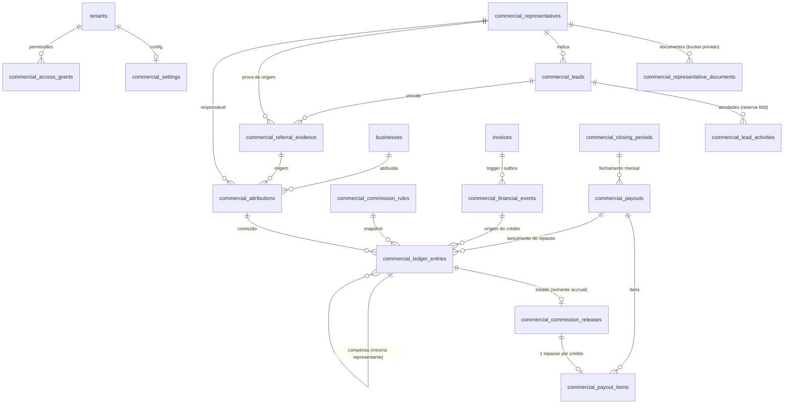

# Módulo Comercial Nacional — Gate 1A: Modelo de Dados e Migrations

**Branch:** `feature/commercial-module` (a partir da `main` limpa e igual ao `origin/main`)
**Parecer técnico:** **GO parcial** — aprovado para revisão de código e homologação local; **NO-GO** para aplicação em staging/produção até os testes reais de banco (pgTAP/RLS com JWT, Docker) serem executados. Ver seção 8.

Nada foi aplicado em nenhum banco remoto. Nenhum código de aplicação foi alterado (Asaas, checkout, onboarding, webhooks, planos). Nenhum fluxo avança para o Gate 1B sem aprovação expressa.

---

## 1. Inventário

### Migrations (`supabase/migrations/`) — apenas arquivos novos, nenhuma migration histórica tocada

| Arquivo | Conteúdo |
|---|---|
| `228_commercial_foundation.sql` | `commercial_settings`, `commercial_access_grants`, `commercial_representatives`, `commercial_representative_documents`, bucket **privado** `commercial-documents`, extensão `btree_gist` |
| `229_commercial_leads_attributions.sql` | `commercial_leads`, `commercial_lead_activities`, `commercial_referral_evidence`, `commercial_attributions` + guardas de imutabilidade |
| `230_commercial_commission_rules.sql` | `commercial_commission_rules` (versionadas, vigência sem sobreposição, imutáveis após ativas) |
| `231_commercial_financial_events.sql` | `commercial_financial_events` (outbox), `commercial_capture_failures`, funções de captura, **trigger em `invoices`**, view `commercial_capture_gaps`, `commercial_reconcile_capture()` |
| `232_commercial_ledger_payouts.sql` | `commercial_closing_periods`, `commercial_payouts`, `commercial_ledger_entries` (append-only), `commercial_commission_releases` (estado), `commercial_payout_items`, view `commercial_representative_balances` |
| `233_commercial_security_audit.sql` | Auditoria que **falha a migration** se alguma tabela `commercial_*` ficar sem RLS ou acessível a `anon`/`authenticated`, ou se o bucket não for privado |

### Rollbacks (`supabase/rollbacks/commercial/`) — fora de `migrations/` de propósito
A migration 217 mantém o rollback dentro de `migrations/`, o que o faria rodar em ordem durante um `db reset`. Aqui ficam separados. Ordem: 232 → 231 → 230 → 229 → 228.
Tabelas financeiras com dados **nunca** são apagadas (nem com chave de override); configuração e rascunhos só com `SET commercial.allow_destructive_rollback = 'on'`.

### Testes e scripts
- `scripts/test-migration-228-233-commercial.mjs` (`pnpm test:commercial-db`) — 71 verificações em PostgreSQL real (PGlite).
- `apps/web/test/commercial-migrations.static.test.ts` — 11 verificações estáticas, no `pnpm test` normal.

---

## 2. Diagrama das tabelas



Convenções: UUID, `tenant_id` em tudo, FKs **compostas** `(tenant_id, id)` (garante o mesmo tenant), `BIGINT` centavos, `INT` basis points, `updated_at` via `update_updated_at()` (verificada: serve).

---

## 3. Proteções contra duplicidade e inconsistência

| Risco | Proteção |
|---|---|
| Evento financeiro duplicado | `UNIQUE (tenant_id, idempotency_key)` + `UNIQUE (invoice_id, seq) WHERE source_kind='invoice_trigger'`; a chave é `invoice:<id>:seq:<n>` (estado de liquidação, não horário do trigger); sem mudança de valor liquidado não há evento |
| Comissão em duplicidade | `UNIQUE (tenant_id, financial_event_id, attribution_id) WHERE entry_type='accrual'` + `UNIQUE (tenant_id, idempotency_key)` |
| Pagamento em duplicidade | `UNIQUE (release_id)` em `commercial_payout_items` |
| Dois representantes na mesma empresa | `UNIQUE (tenant_id, business_id) WHERE status='confirmed'`; um pendente por (empresa, representante); um vínculo vivo por lead |
| Dois representantes reservando o mesmo prospect | `UNIQUE (tenant_id, dedupe_key)` para leads ativos |
| Regras com vigência conflitante | `EXCLUDE USING gist` (tenant, representante, plano, tipo, prioridade, `tstzrange`) para regras ativas |
| Períodos de fechamento sobrepostos | `EXCLUDE USING gist` em `daterange` |
| Representante duplicado | `UNIQUE` por documento (hash), por `user_id` e por código `REP-XXXXXX` (formato disjunto de convites e de `member_referral_codes`) |
| Alteração de histórico | Ledger: trigger bloqueia UPDATE/DELETE/TRUNCATE; atribuição confirmada, regra ativa e evidência: guardas de imutabilidade |
| Valores fora de faixa | `CHECK` de sinal por tipo de lançamento, `rate_bps` 0–10000, `amount_cents > 0` etc. |

---

## 4. Políticas de segurança (estado do Gate 1A e previsto)

**Gate 1A (implementado e auditado pela migration 233):**
- RLS habilitada em **todas** as 16 tabelas; nenhum privilégio para `anon`/`authenticated`/`PUBLIC`; policy `FOR ALL TO service_role` apenas.
- Bucket `commercial-documents` **privado** (10 MB; PDF/JPEG/PNG/WebP), sem policies em `storage.objects` → somente servidor via URL assinada.
- Funções privilegiadas (`SECURITY DEFINER`) com `search_path = pg_catalog, pg_temp`, objetos qualificados, `REVOKE` de `PUBLIC/anon/authenticated`.
- `profiles.role` **não** foi alterado; `finance` continua fora do `/admin`.
- Documento e chave PIX: só hash, últimos dígitos e valor **cifrado pela aplicação** no banco.

**Previsto para o Gate 1B (não implementado):** funções `has_commercial_permission(tenant, permission)` sobre `commercial_access_grants`; políticas do representante (somente os próprios dados, via `commercial_representatives.user_id`) — um usuário pode ser anunciante **e** representante; área própria `/representante` (como `/anunciante`, fora do middleware de `/admin`); enforcement server-side das permissões; policies de storage por pasta.

---

## 5. Captura financeira (trigger + outbox)

- Trigger `trg_commercial_invoice_capture` em `invoices` (`AFTER INSERT OR UPDATE OF status, amount_paid, amount_due, paid_at`), mesma transação do pagamento.
- Cobre: inserção direta como paga, atualização de valor recebido, repetição da confirmação (idempotente), correções administrativas, parcial/ajuste e redução (reversão com `requires_review`).
- **Valor efetivamente recebido** (`amount_paid` em centavos), não o valor de tabela: R$ 500 contratados, R$ 400 pagos → base R$ 400 (15% = R$ 60).
- Duas chaves **independentes**: `capture_mode` (`off` | `shadow` | `strict`) e `module_enabled`. Ambas desligadas por padrão; a operação exige captura ligada; a captura exige um **marco de início** (`capture_starts_at`) para não gerar comissão retroativa.
- `shadow`: falha de captura **nunca** bloqueia o pagamento; é gravada em `commercial_capture_failures`, aparece em `commercial_capture_gaps` (comparação fatura × eventos) e é recuperada por `commercial_reconcile_capture()`. `strict` (homologação): a falha aborta a transação.
- Permuta, parceria e valor zero: evento `skipped` + `requires_review` (nunca comissão automática).
- Estorno/chargeback: `event_type` e `source_kind` já previstos; **a integração com Asaas/onboarding é do Gate 1D** e depende de autorização específica do plano de alteração.

---

## 6. Testes executados

| Suíte | Resultado |
|---|---|
| `pnpm test:commercial-db` (PGlite, PostgreSQL real, 6 migrations + rollbacks) | **71 / 71** |
| `commercial-migrations.static.test.ts` | **11 / 11** |
| `pnpm --filter mobile typecheck` e `test` (58) | passam (não houve mudança no mobile) |
| `pnpm --filter web typecheck` | passa |
| `pnpm --filter web exec vitest run` (suíte completa) | 1312 aprovados, **30 reprovados — os mesmos 30 anteriores à branch** (11 arquivos, nenhum relacionado ao módulo) |

Cobertura dos 71: aplicação e re-execução idempotente; RLS/privilégios por papel (`SET ROLE anon|authenticated|service_role`); captura (off, liquidação, repetição, parcial, ajuste, reversão, antes do marco, permuta/parceria, `authenticated` confirmando pagamento); falha em `shadow` (pagamento preservado + registro + lacuna + recuperação) e `strict`; representantes, leads, evidência, atribuições; regras (vigência, aprovação, imutabilidade, ilustrativa); ledger (sinais, duplicidade, compensação, append-only incl. `TRUNCATE ... CASCADE`); liberações, repasses, fechamento; rollbacks (limpa, recusa com dados, restaura `invoices`).

---

## 7. Impacto sobre o sistema existente

- **Único objeto novo em tabela existente:** o trigger em `public.invoices`. Com a captura desligada, executa uma consulta por chave primária em `commercial_settings` e retorna. Nenhum código de aplicação muda.
- Nenhum `ALTER TABLE` em tabela existente; nenhum `DROP`/`TRUNCATE`/`DELETE`; nenhuma migration histórica modificada (verificado por teste via `git diff`).
- **Efeito colateral intencional, só com o módulo em uso:** empresas/faturas com eventos, atribuições, créditos ou leads vencidos **não podem ser apagadas** (`ON DELETE RESTRICT`, proteção financeira). Fluxos de exclusão definitiva de empresa precisarão tratar isso em gate posterior. Hoje, sem dados comerciais, não há mudança.
- Premissa confirmada no código: faturas abertas nascem com `amount_paid = 0`; `amount_paid > 0` só aparece com `status = 'paid'` (fluxos 076, 213, baixa manual, onboarding). A liquidação parcial está suportada, mas hoje não é produzida.

---

## 8. Riscos, limitações e GO/NO-GO

**Limitações (não homologado):**
1. **Docker/pgTAP indisponíveis** neste computador. Os testes de **RLS com JWT real**, políticas de `storage.objects` e `supabase db reset` completo **não foram executados**. PGlite valida SQL, constraints, triggers e privilégios por papel, mas não é o Supabase.
2. `btree_gist` precisa estar disponível no projeto Supabase (extensão padrão; verificar com `list_extensions` antes de aplicar).
3. As migrations 150/205 foram verificadas: `businesses.plan_tier` aceita `esquadro/compasso/acacia` (CHECK `NOT VALID`); as regras usam o código canônico. O CHECK vigente de `profiles.role` está na 140. Conferir no banco real, pois o histórico tem CHECKs reescritos várias vezes.
4. A base de comissão "valor bruto recebido" ainda não foi validada contabilmente (taxas, impostos, modalidades especiais).
5. Percentuais e condições comerciais **não foram semeados**; regra ilustrativa não pode ser habilitada por constraint.

**Observação fora do escopo (já existente):** a migration 205 impõe no banco o teto de **25 serviços** para Acácia, divergente das cotas de `plan_entitlements` (10). Relevante para o ajuste de limites feito anteriormente.

| Decisão | Parecer |
|---|---|
| Aprovação técnica do modelo e revisão de código | **GO** |
| Homologação local (PGlite + estático) | **GO — concluída** |
| Aplicação em staging/produção | **NO-GO** até: (a) pgTAP/RLS reais em ambiente com Docker; (b) conferência do banco-alvo (ref do projeto, `btree_gist`, CHECKs); (c) aprovação expressa |
| Avançar ao Gate 1B | **Aguardando aprovação expressa** |

### Conferência no banco real (executada pelo responsável após aplicar 228–233)
Ambiente: **PRODUÇÃO** (aplicado pelo responsável, sem homologação prévia em staging). A migration 233 (auditoria) passou na aplicação.

| Verificação | Resultado |
|---|---|
| Extensão `btree_gist` | presente |
| Tabelas `commercial_*` / com RLS | 16 / 16 |
| `commercial_settings` (módulo inerte) | 0 linhas |
| Triggers em `invoices` | `trg_commercial_invoice_capture`, `trg_invoices_updated_at` |
| Bucket `commercial-documents` | privado, 10 MB |

Continuam **pendentes**: pgTAP/RLS com JWT real (exige Docker) e o teste de não-regressão de um pagamento real em ambiente de teste.

### Como reproduzir
```bash
pnpm test:commercial-db
pnpm --filter web exec vitest run test/commercial-migrations.static.test.ts
```
